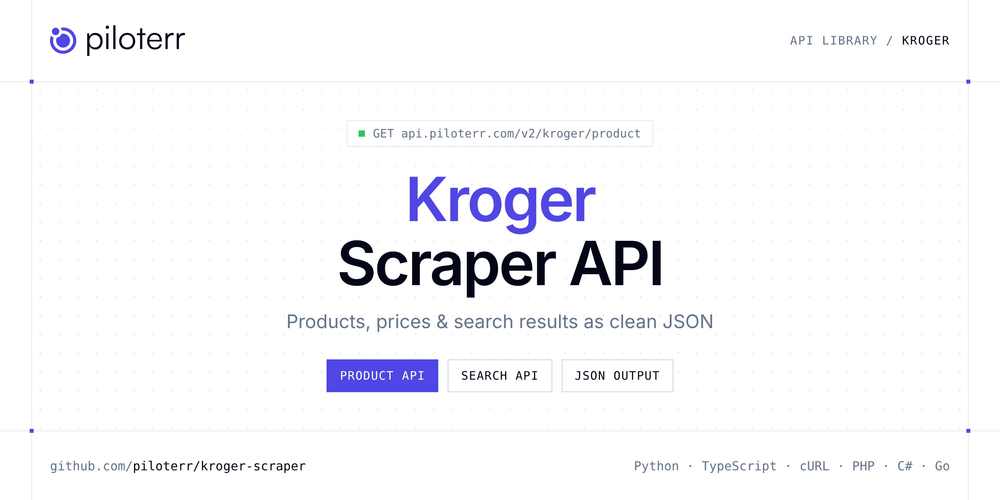

<p align="center">
  <a href="https://www.piloterr.com"></a>
</p>

# Kroger Scraper API

[](https://discord.gg/CFj3ph8aHU) [](https://app.piloterr.com) [](https://app.piloterr.com/openapi) [](LICENSE)

The **Piloterr Kroger Scraper API** lets you extract public data from Kroger as **clean, structured JSON** — no proxies, headless browsers or HTML parsing to maintain. Endpoints available in production:

- **Kroger Product API** — Read one Kroger product by UPC.
- **Kroger Search API** — Search Kroger groceries by keyword and page the results.

Use it for price monitoring, assortment tracking, competitor analysis, product research or catalog enrichment.

| Endpoint | Path | Credits | What you get |
|---|---|---|---|
| [Kroger Product API](#kroger-product-api) | `/v2/kroger/product` | 2 | Read one Kroger product by UPC. The sheet uses the same default store as search. You get the shelf price and the previous price when Kroger shows one. |
| [Kroger Search API](#kroger-search-api) | `/v2/kroger/search` | 2 | Search Kroger groceries by keyword and page the results. Prices come from the default pickup store returned in the response. A location id you pass is not applied. |

## Table of contents

- [How it works](#how-it-works)
- [Kroger Product API](#kroger-product-api)
- [Kroger Search API](#kroger-search-api)
- [Code examples in other languages](#code-examples-in-other-languages)
- [Practical use cases](#practical-use-cases)
- [Why Piloterr?](#why-piloterr)
- [FAQ](#faq)
- [Related scrapers](#related-scrapers)
- [Support](#support)

## How it works

1. **Create a free Piloterr account** and copy your API key from the [dashboard](https://app.piloterr.com).
2. **Send a `GET` (or `POST`) request** to `https://api.piloterr.com/v2/...` with the header `x-api-key: YOUR_API_KEY`.
3. **Receive structured JSON** — Piloterr handles rendering, proxies, retries and parsing.

```bash
export PILOTERR_API_KEY="your-api-key"
pip install requests        # Python
# TypeScript: Node.js 18+ (native fetch), run with `npx tsx file.ts`
```

> Every endpoint accepts both `GET` (query string) and `POST` (JSON body with the same fields).

## Kroger Product API

Read one Kroger product by UPC. The sheet uses the same default store as search. You get the shelf price and the previous price when Kroger shows one.

`GET | POST https://api.piloterr.com/v2/kroger/product` · **2 credits per request** · [Full reference](https://app.piloterr.com/openapi)

### Request parameters

| Parameter | Type | Required | Description |
|---|---|---|---|
| `query` | string | ✅ | Kroger product URL or UPC. |
| `location_id` | string | — | Ignored. Prices stay on the default Rolla store, 02100537 (Kroger, 605 W 4th St, Rolla, MO 65401). The response location_id is the store that was actually priced. |
| `return_page_source` | boolean | — | When true, return rendered HTML instead of JSON. |

### Python example

```python
import json
import os
import requests

response = requests.get(
    "https://api.piloterr.com/v2/kroger/product",
    headers={"x-api-key": os.environ["PILOTERR_API_KEY"]},
    params={
        "query": "0001111040101",
    },
    timeout=60,
)
response.raise_for_status()
data = response.json()

print(json.dumps(data, indent=2, ensure_ascii=False)[:2000])
```

### TypeScript example

```typescript
type KrogerProduct = {
  id?: string;
  url?: string;
  size?: string;
  aisle?: string;
  brand?: string;
  image?: string;
  price?: number;
  title?: string;
  rating?: number;
  currency?: string;
  in_stock?: boolean;
  was_price?: unknown;
  store_name?: string;
  description?: string;
  location_id?: string;
  review_count?: number;
  price_display?: string;
  store_address?: string;
  unit_price_display?: string;
};

const params = new URLSearchParams({
  "query": "0001111040101",
});

const response = await fetch(`https://api.piloterr.com/v2/kroger/product?${params}`, {
  headers: { "x-api-key": process.env.PILOTERR_API_KEY! },
});
if (!response.ok) throw new Error(`Piloterr error ${response.status}: ${await response.text()}`);

const data = (await response.json()) as KrogerProduct;

console.log(JSON.stringify(data, null, 2).slice(0, 2000));
```

<details>
<summary><b>POST variant</b></summary>

```http
POST https://api.piloterr.com/v2/kroger/product
x-api-key: YOUR_API_KEY
Content-Type: application/json

{"query": "0001111040101"}
```
</details>

### Output example

Example response from the API reference, abridged — real values depend on the page you scrape.

```json
{
  "id": "0001111040101",
  "url": "https://www.kroger.com/p/kroger-vitamin-d-whole-milk-gallon/0001111040101",
  "size": "1 gal",
  "aisle": "DAIRY 100",
  "brand": "Kroger",
  "image": "https://www.kroger.com/product/images/large/front/0001111040101",
  "price": 3.19,
  "title": "Kroger® Vitamin D Whole Milk Gallon",
  "rating": 2.85,
  "currency": "USD",
  "in_stock": true,
  "was_price": null,
  "store_name": "Rolla",
  "description": "Kroger® Vitamin D Whole Milk Gallon is full of refreshing goodness. Enriched with Vitamin D to brighten your day and strengthen your bone…",
  "location_id": "02100537",
  "review_count": 102,
  "price_display": "$3.19",
  "store_address": "605 W 4Th St, Rolla, MO 65401",
  "unit_price_display": "$0.02/fl oz"
}
```

### Response fields

| Field | Type | Description |
|---|---|---|
| `id` | string |  |
| `url` | string |  |
| `size` | string |  |
| `aisle` | string |  |
| `brand` | string |  |
| `image` | string |  |
| `price` | number |  |
| `title` | string |  |
| `rating` | number |  |
| `currency` | string |  |
| `in_stock` | boolean |  |
| `was_price` | object |  |
| `store_name` | string |  |
| `description` | string |  |
| `location_id` | string |  |
| `review_count` | integer |  |
| `price_display` | string |  |
| `store_address` | string |  |
| `unit_price_display` | string |  |

## Kroger Search API

Search Kroger groceries by keyword and page the results. Prices come from the default pickup store returned in the response. A location id you pass is not applied.

`GET | POST https://api.piloterr.com/v2/kroger/search` · **2 credits per request** · [Full reference](https://app.piloterr.com/openapi)

### Request parameters

| Parameter | Type | Required | Description |
|---|---|---|---|
| `query` | string | ✅ | Keyword or a full Kroger search URL. |
| `page` | number | — | Page number, 1-based. |
| `location_id` | string | — | Ignored. Prices stay on the default Rolla store, 02100537 (Kroger, 605 W 4th St, Rolla, MO 65401). The response location_id is the store that was actually priced. |
| `return_page_source` | boolean | — | When true, return rendered HTML instead of JSON. |

### Python example

```python
import json
import os
import requests

response = requests.get(
    "https://api.piloterr.com/v2/kroger/search",
    headers={"x-api-key": os.environ["PILOTERR_API_KEY"]},
    params={
        "query": "milk",
    },
    timeout=60,
)
response.raise_for_status()
data = response.json()

print(json.dumps(data, indent=2, ensure_ascii=False)[:2000])
```

### TypeScript example

```typescript
type KrogerSearch = {
  results?: {
    id?: string;
    url?: string;
    size?: string;
    brand?: string;
    image?: string;
    price?: number;
    title?: string;
    rating?: number;
    currency?: string;
    sponsored?: boolean;
    was_price?: unknown;
    store_name?: string;
    location_id?: string;
    review_count?: number;
    price_display?: string;
    unit_price_display?: string;
  }[];
  pagination?: {
    next?: string;
    page?: number;
    per_page?: number;
    total_pages?: number;
    total_results?: number;
  };
};

const params = new URLSearchParams({
  "query": "milk",
});

const response = await fetch(`https://api.piloterr.com/v2/kroger/search?${params}`, {
  headers: { "x-api-key": process.env.PILOTERR_API_KEY! },
});
if (!response.ok) throw new Error(`Piloterr error ${response.status}: ${await response.text()}`);

const data = (await response.json()) as KrogerSearch;

console.log(JSON.stringify(data, null, 2).slice(0, 2000));
```

<details>
<summary><b>POST variant</b></summary>

```http
POST https://api.piloterr.com/v2/kroger/search
x-api-key: YOUR_API_KEY
Content-Type: application/json

{"query": "milk"}
```
</details>

### Output example

Example response from the API reference, abridged — real values depend on the page you scrape.

```json
{
  "results": [
    {
      "id": "0001111040101",
      "url": "https://www.kroger.com/p/kroger-vitamin-d-whole-milk-gallon/0001111040101",
      "size": "1 gal",
      "brand": "Kroger",
      "image": "https://www.kroger.com/product/images/large/front/0001111040101",
      "price": 3.19,
      "title": "Kroger® Vitamin D Whole Milk Gallon",
      "rating": 2.85,
      "currency": "USD",
      "sponsored": false,
      "was_price": null,
      "store_name": "Rolla",
      "location_id": "02100537",
      "review_count": 102,
      "price_display": "$3.19",
      "unit_price_display": "$0.02/fl oz"
    }
  ],
  "pagination": {
    "next": "https://www.kroger.com/search?query=milk&searchType=default_search&page=2",
    "page": 1,
    "per_page": 27,
    "total_pages": 6,
    "total_results": 161
  }
}
```

### Response fields

| Field | Type | Description |
|---|---|---|
| `results[]` | object[] |  |
| `results[].id` | string |  |
| `results[].url` | string |  |
| `results[].size` | string |  |
| `results[].brand` | string |  |
| `results[].image` | string |  |
| `results[].price` | number |  |
| `results[].title` | string |  |
| `results[].rating` | number |  |
| `results[].currency` | string |  |
| `results[].sponsored` | boolean |  |
| `results[].was_price` | object |  |
| `results[].store_name` | string |  |
| `results[].location_id` | string |  |
| `results[].review_count` | integer |  |
| `results[].price_display` | string |  |
| `results[].unit_price_display` | string |  |
| `pagination` | object |  |
| `pagination.next` | string |  |
| `pagination.page` | integer |  |
| `pagination.per_page` | integer |  |
| `pagination.total_pages` | integer |  |
| `pagination.total_results` | integer |  |

## Code examples in other languages

Ready-to-run examples live in the [`examples/`](examples) folder. Each one reads your key from the `PILOTERR_API_KEY` environment variable.

| Language | Product | Search |
|---|---|---|
| cURL (Bash) | [`product`](examples/curl/product.sh) | [`search`](examples/curl/search.sh) |
| PHP | [`product`](examples/php/product.php) | [`search`](examples/php/search.php) |
| C# | [`product`](examples/csharp/Product.cs) | [`search`](examples/csharp/Search.cs) |
| Go | [`product`](examples/go/product.go) | [`search`](examples/go/search.go) |
| Java | [`product`](examples/java/ProductExample.java) | [`search`](examples/java/SearchExample.java) |
| Ruby | [`product`](examples/ruby/product.rb) | [`search`](examples/ruby/search.rb) |
| Node.js | [`product`](examples/nodejs/product.mjs) | [`search`](examples/nodejs/search.mjs) |

## Practical use cases

- **Price monitoring** — Track prices, promotions and availability over time to react to competitors.
- **Assortment & catalog tracking** — Follow new products, delisted items and category changes.
- **Competitor analysis** — Benchmark ranges, brands and positioning across retailers.
- **Product research** — Spot best-sellers and trends from search results.
- **Catalog enrichment** — Pull titles, images and attributes into your PIM or marketplace listings.

## Why Piloterr?

- **No infrastructure** — no proxies, headless browsers or CAPTCHA solving to run yourself.
- **Structured JSON** — stable, documented fields instead of brittle HTML selectors.
- **Pay per request** — transparent credit cost per endpoint, failed requests are retried for you.
- **One API key, hundreds of sources** — Kroger plus many other e-commerce, search and company data endpoints in the [Piloterr library](https://www.piloterr.com/library).
- **Any language** — plain HTTPS + JSON, with examples for Python, TypeScript, cURL, PHP, C#, Go, Java, Ruby and Node.js.

## FAQ

### Is it legal to scrape Kroger?

Collecting publicly available data is generally allowed in many jurisdictions, but rules depend on your country, the data you collect and how you use it. Avoid personal data unless you have a lawful basis, respect the website's terms where they apply, and get legal advice for your specific use case. This is not legal advice.

### Do I need proxies or a headless browser?

No. Piloterr handles rendering, proxy rotation and retries on its side. You only send an HTTPS request with your `x-api-key` header and receive JSON.

### How much does a request cost?

Credits per call: `/v2/kroger/product` **2**, `/v2/kroger/search` **2**. See the [Piloterr website](https://www.piloterr.com) for plans.

### What data does the Kroger API return?

Each endpoint returns structured JSON: **Kroger Product** — `id`, `url`, `size`, `aisle`, `brand`, `image`; **Kroger Search** — `results[]`, `results[].id`, `results[].url`, `results[].size`, `results[].brand`, `results[].image`.

### How do I paginate Kroger results?

Use the `page` parameter and keep requesting while the response indicates more results.

### Can I get the raw HTML instead of JSON?

Yes. Set `return_page_source=true` and the response becomes `{"result": "..."}` with the page source.

### Which languages are supported?

Any language that can make an HTTP request. This README shows Python and TypeScript; the [`examples/`](examples) folder contains cURL, PHP, C#, Go, Java, Ruby and Node.js.

## Related scrapers

- [About You Scraper API](https://github.com/piloterr/aboutyou-scraper)
- [Action Scraper API](https://github.com/piloterr/action-scraper)
- [Aldi Scraper API](https://github.com/piloterr/aldi-scraper)
- [Alibaba Scraper API](https://github.com/piloterr/alibaba-scraper)
- [AliExpress Scraper API](https://github.com/piloterr/aliexpress-scraper)
- [Allegro Scraper API](https://github.com/piloterr/allegro-scraper)
- [All Piloterr scrapers on GitHub](https://github.com/piloterr)

## Support

- 💬 Join the [Piloterr Discord](https://discord.gg/CFj3ph8aHU) to ask questions and share what you build.
- 📚 Browse the [API reference (OpenAPI)](https://app.piloterr.com/openapi) and the [Piloterr library](https://www.piloterr.com/library).
- 🔑 [Get your API key](https://app.piloterr.com).

---

<p align="center">
  <a href="https://www.piloterr.com">
    <picture>
      <source media="(prefers-color-scheme: dark)" srcset="images/logo-dark.svg">
      
    </picture>
  </a>
  <br>
  <sub>Built by <a href="https://www.piloterr.com">Piloterr</a> — web scraping APIs for e-commerce, search, real estate and more, one API key.</sub>
</p>

<sub>Kroger is a trademark of its respective owner. This repository is not affiliated with or endorsed by Kroger. Examples are released under the MIT license.</sub>
